<!-- Banner -->


<div align="center">

<a href="https://git.io/typing-svg"></a>

<a href="https://www.linkedin.com/in/nicolas-ferezini/"></a>
<a href="mailto:nicolasferezini22@gmail.com"></a>


<!-- Descomente quando houver conteúdo publicado:
<a href="https://huggingface.co/SEU_USUARIO"></a>
<a href="https://www.kaggle.com/SEU_USUARIO"></a>
-->

</div>

---

### `> whoami`

```python
nicolas = {
    "papel":      "Estagiário de IA e Full Stack @ Leancys",
    "formação":   "Engenharia de Software · IFSP São Carlos (conclusão 2027)",
    "construo":   ["agentes de LLM com RAG e guardrails", "agente de voz em produção", "visão computacional local"],
    "princípio":  "se não tem métrica, ainda não está pronto",
    "agora":      ["fine-tuning com LoRA", "serving de modelos", "LLMOps"],
}
```

---

### `> projetos`

<table>
<tr>
<td width="50%" valign="top">

#### 📝 Corrige.AI
<sub>🔒 código privado</sub>

Correção de provas de matemática feitas em papel com um modelo de visão **rodando local, sem GPU**. O professor fotografa pelo celular e recebe transcrição, nota com crédito parcial e justificativa.

**⚡ Tempo por aluno: ~13 → ~7 min na CPU**, otimizando as imagens enviadas ao modelo.

   

</td>
<td width="50%" valign="top">

#### 🕐 [escritor.io](https://github.com/fereziniNi/escritor.io)
<sub>🟢 em uso diário</sub>

Ponto, tarefas e escritório virtual 2D. Ponto imutável com hash SHA-256 encadeado. Feito com Claude Code em TDD.

**⚡ 4 pessoas usam todo dia · fechamento mensal de ~3 h virou exportação automática · 1.275 testes**

   

</td>
</tr>
<tr>
<td width="50%" valign="top">

#### 📚 [llm-rag-local-pdf](https://github.com/fereziniNi/llm-rag-local-pdf)
<sub>🌐 código aberto</sub>

RAG **100% offline** para PDFs (texto e tabelas): chunking semântico, embeddings, reranking e citação de arquivo e página em cada resposta.

<!-- Após a tarefa 3.1, acrescente: **⚡ Reranking: recall@5 de A% → B% em 40 perguntas** -->

   

</td>
<td width="50%" valign="top">

#### 🌱 Embrapa ILPF
<sub>👥 em equipe · 🔒 código privado</sub>

Sistema web da Embrapa para **Integração Lavoura-Pecuária-Floresta**, construído por um time de 16 desenvolvedores.

<!-- Acrescente aqui a sua parte, em uma linha: "Minha parte: ..." -->

   

</td>
</tr>
</table>

<!--
Quando o copiloto (frente 2) estiver pronto, adicione esta linha na tabela acima, como PRIMEIRA <tr>:
<tr>
<td colspan="2" valign="top">

#### 🍽️ [Copiloto de dados para restaurantes](https://github.com/fereziniNi/REPO) · [demo](LINK)
Agente que responde perguntas de donos de restaurante via servidor MCP próprio, com evals no CI, guardrails e tracing.

**⚡ X% de exatidão em N casos · Y de 40 ataques bloqueados · 3 modelos comparados em custo e qualidade**

</td>
</tr>
-->

<details>
<summary><b>🚧 Em construção agora</b></summary>
<br/>

- **Copiloto de dados para restaurantes:** agente com servidor MCP próprio, evals no CI, guardrails contra prompt injection e tracing.
- **Classificador de reclamações em português com LoRA**, para publicar no Hugging Face com model card.
- **Previsão de tempo de entrega** no Kaggle, com faixa de incerteza p10–p90.

</details>

---

### `> stack`

<div align="center">

**IA e LLMs**<br/>


<br/><br/>

**Engenharia**<br/>
<a href="https://skillicons.dev"></a>

</div>

---

### `> atividade`

<div align="center">


<picture>
  <source media="(prefers-color-scheme: dark)" srcset="https://raw.githubusercontent.com/fereziniNi/fereziniNi/output/github-snake-dark.svg"/>
  <source media="(prefers-color-scheme: light)" srcset="https://raw.githubusercontent.com/fereziniNi/fereziniNi/output/github-snake.svg"/>
  
</picture>

</div>

<!-- Footer -->

